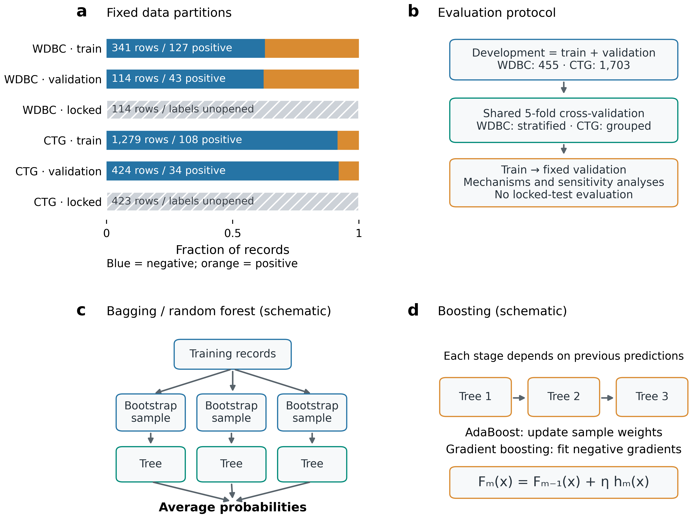
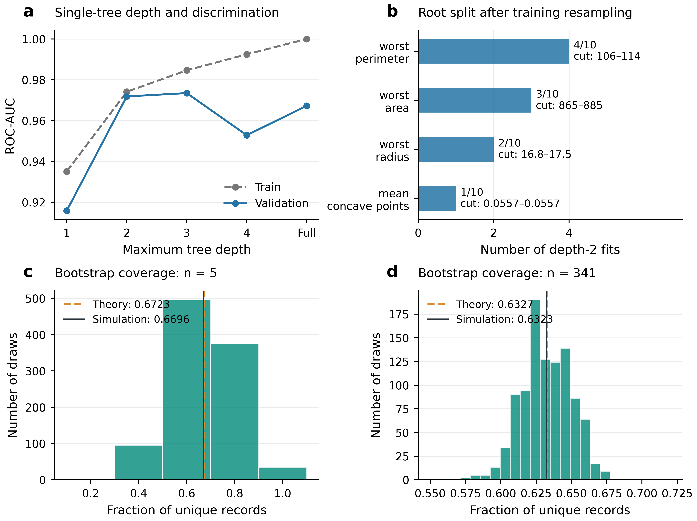
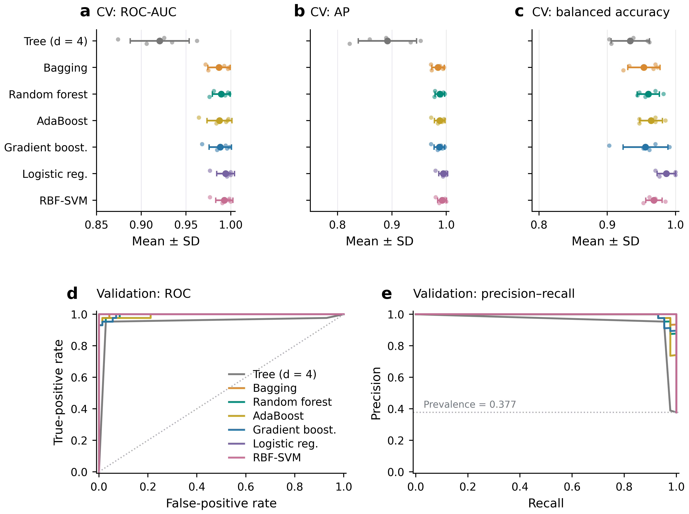
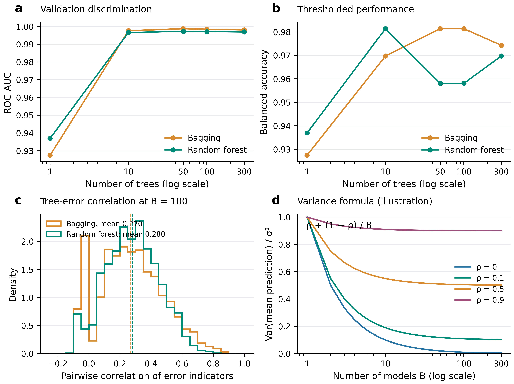
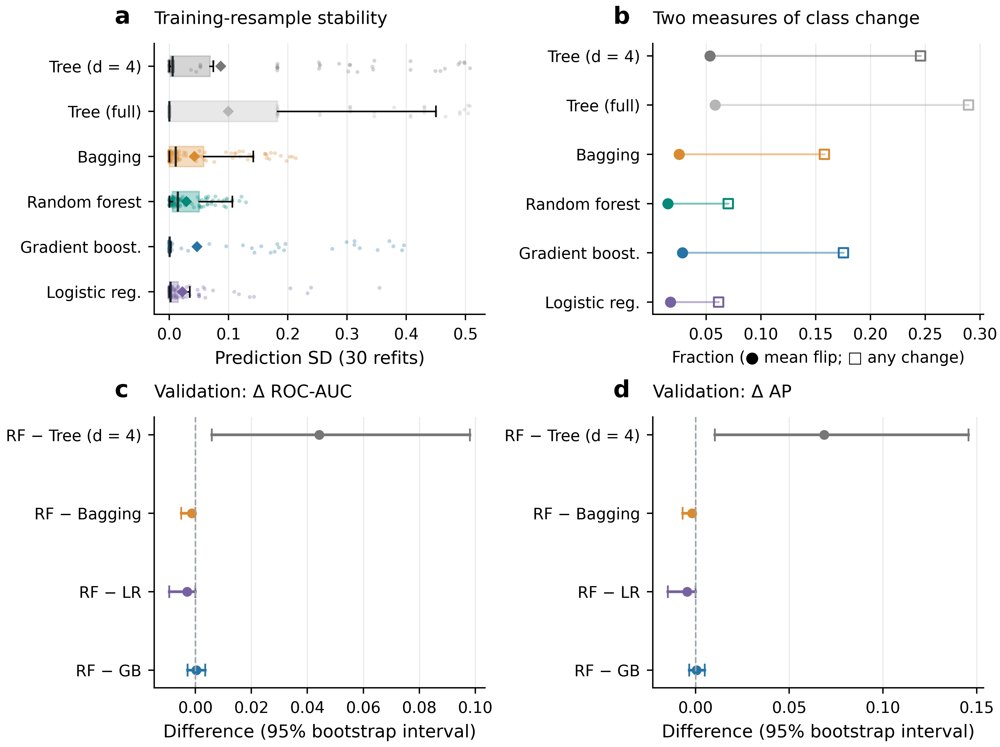
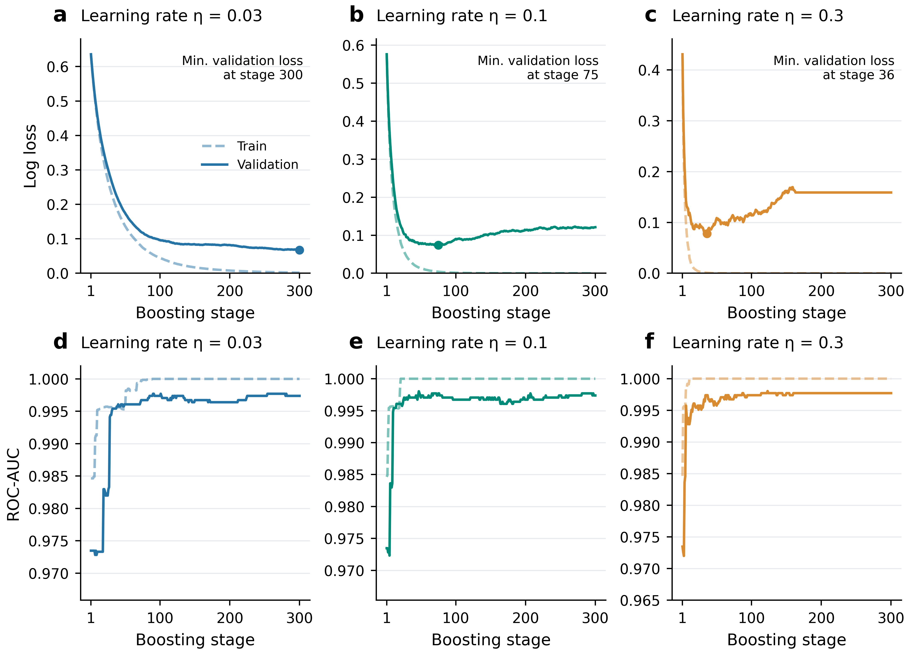
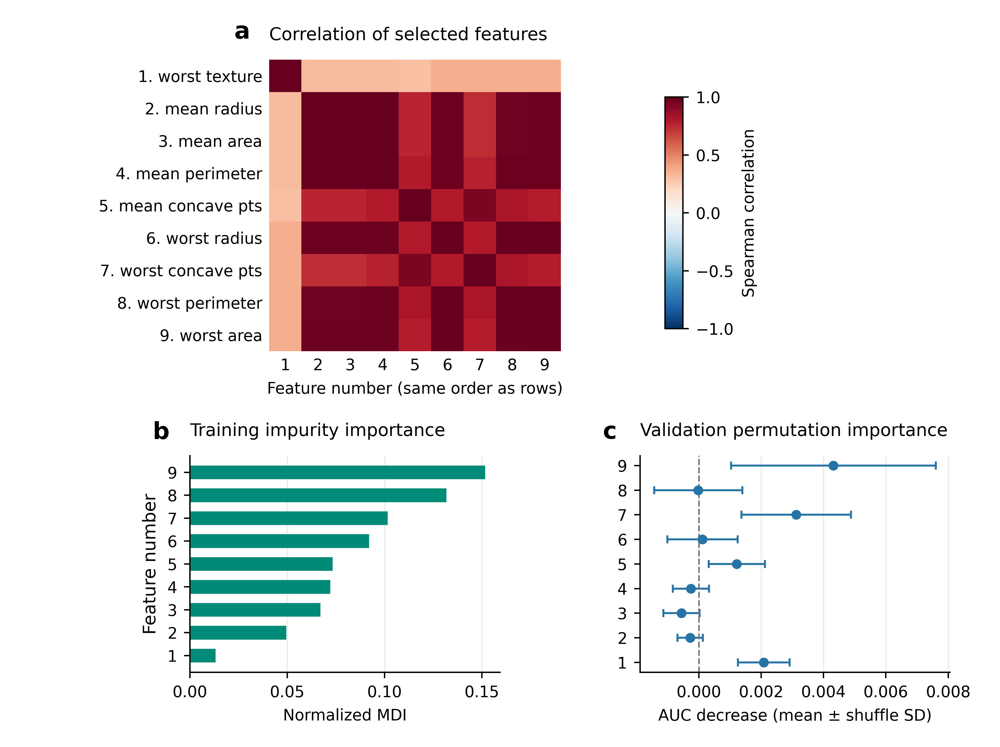
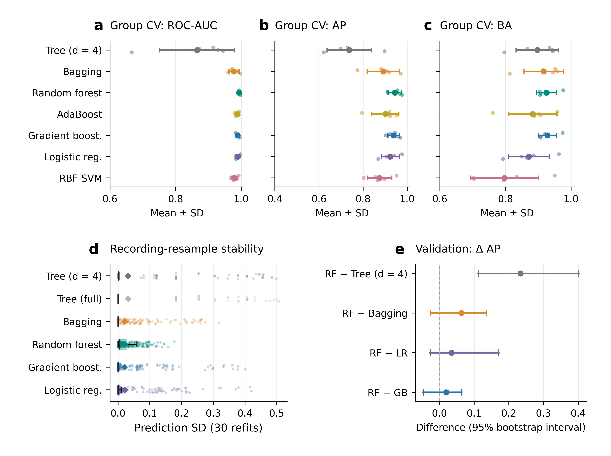

# 生物医学表格数据中集成学习的性能与稳定性研究

——基于决策树、Bootstrap 与双数据集内部验证的比较

作者：詹步超　学号：24520260158428　专业：健康大数据与智能医学

第九讲课程作业 · 集成学习与 Bootstrapping

# 摘要

**目的：**比较单棵决策树、Bagging、随机森林与Boosting的预测表现和训练扰动稳定性，检验集成学习相对于逻辑回归与支持向量机的收益，并区分模型稳定性与指标抽样不确定性。**方法：**以课程提供的WDBC乳腺肿块数据为主分析，按固定划分使用341条训练记录与114条验证记录；以CTG胎心监护数据的1279个训练片段和424个验证片段作补充。比较7种预设模型，并增加完全生长单树作为机制对照；开发集采用共享5折交叉验证，CTG按录音分组。实施30次共享训练集Bootstrap重拟合、2000次固定验证预测的配对Bootstrap，以及树深度、树数、学习率和重要性分析。锁定测试标签不参与分析。**结果：**WDBC开发集ROC-AUC均值±折间SD分别为深度4单树0.9205±0.0329、Bagging 0.9869±0.0125、随机森林0.9893±0.0100及逻辑回归0.9942±0.0099。单树、Bagging和随机森林的验证样本平均预测概率SD依次为0.0870、0.0422和0.0289。随机森林在WDBC上的树错误相关未低于Bagging，而在CTG上由0.6128降至0.3837。CTG随机森林的分组CV平均精确率为0.9442±0.0309，高于逻辑回归的0.9231±0.0403，但验证AP差值的录音簇Bootstrap区间跨越0。学习率0.1的梯度提升在WDBC验证集上的log-loss于75轮附近最低，随后升高。**结论：**本数据中集成可改善单树的排序能力和训练扰动稳定性，但不能据此认定其普遍优于简单基线。WDBC优先保留逻辑回归与SVM，CTG保留随机森林与梯度提升作为候选；选型须同时考虑评价指标、验证单位、解释成本及证据范围。

**关键词：**集成学习；Bagging；随机森林；梯度提升；Bootstrap；分组验证

# 1 引言

决策树通过递归切分特征空间形成预测规则，能够表达非线性与变量交互，但贪心切分易受训练样本扰动影响。Bagging通过有放回重抽样训练多个学习器并平均预测，随机森林进一步在每个分裂节点随机限制候选特征；Boosting则顺序构建学习器，使新模型针对前序模型尚未解释的误差进行更新[1–4]。三者的收益机制不同，不能仅凭“树更多”推断预测表现更好。

本研究围绕课程工作单A–H，提出三个问题：第一，集成是否改善单树的泛化与稳定性；第二，额外特征随机化及Boosting轮数如何影响收益；第三，当模型与逻辑回归、RBF-SVM公平比较时，复杂度增加是否有充分证据支持。研究保留不利于集成的结果，以免将机制预期替代实际观察。

# 2 资料与方法

## 2.1 数据来源与分析单位

主分析使用WDBC数据[5]，每行是一份乳腺肿块细针穿刺图像的细胞核形态特征记录，含30个连续预测变量，标签重编码为恶性=1。固定训练集341条，其中恶性127条；验证集114条，其中恶性43条。另有114条锁定测试记录，本研究仅核验其标识隔离，不读取测试标签。

CTG补充分析[6]包含21个输入特征，病理型=1，正常与可疑合为0。训练集1279个片段来自209个录音，阳性108个；验证集424个片段来自73个录音，阳性34个；另423个锁定片段来自70个录音。片段并非孕妇个体，录音文件也不能直接等同于独立孕妇。两数据集分别建模，不合并分析。

## 2.2 数据审计、预处理与模型设定

两数据集训练与验证特征均无缺失。WDBC训练、验证集均无重复特征行；CTG分别存在12条和2条重复特征行。由于不同片段可具有相同测量特征，保留这些记录，并以录音隔离作为验证的基本约束。标识列`sample_id`和`recording_id`不作为输入；后者仅用于分组。该审计不证明不同录音一定来自不同个体。

所有模型使用相同训练记录、标签和验证指标。逻辑回归与RBF-SVM置于StandardScaler管道内，交叉验证时仅在训练折拟合标准化参数。树模型不标准化。基础随机种子为1010，模型与参数在实验前保存为协议文件；主比较不根据验证曲线重新拟合“最优参数”。表1给出7种主模型，另增加完全生长单树，使其与Bagging的基树复杂度保持一致。

**表1　预设模型及关键参数。**默认参数以随附`protocol.json`为准。

| 模型 | 设定 | 比较目的 |
|:--|:--|:--|
| Tree（depth 4） | Gini；max_depth=4 | 对应课程单树基线 |
| Tree（full depth） | max_depth=None | 控制Bagging基树复杂度的补充对照 |
| Bagging | 100棵完全生长树；样本有放回；全部特征 | 观察重抽样与平均的作用 |
| Random forest | 100棵树；每节点max_features=sqrt | 观察额外特征随机化 |
| AdaBoost | 50个默认树桩；learning_rate=1 | 顺序重加权机制 |
| Gradient boosting | 100轮；learning_rate=0.1；max_depth=3 | 顺序负梯度更新 |
| Logistic regression | 折内标准化；L2；C=1；max_iter=5000 | 线性、低解释成本基线 |
| RBF-SVM | 折内标准化；C=1；gamma=scale | 核方法非线性基线 |

## 2.3 验证协议与评价指标

首先在原始train上拟合，在固定validation上评价。其次，将train与validation合为开发集，WDBC采用共享5折分层交叉验证，CTG采用共享5折StratifiedGroupKFold，保证每个录音仅属于一个验证折。所有模型使用相同折索引。开发集CV与固定验证结果来自相互重叠的数据，不能视作两次独立复现。

报告ROC-AUC、平均精确率（average precision，AP）及balanced accuracy（BA）。AP采用sklearn的非插值加权定义，不能与梯形积分PR-AUC混用。CTG阳性比例较低，因此同时重视AP和BA；AP的无信息参考线为相应评价集阳性比例。BA为敏感度和特异度的平均，受分类阈值影响。

分类使用各估计器默认`predict`规则，概率模型约以0.5为界，恰好相等时按估计器规则处理；SVM使用决策分数0作为边界。SVM只输出decision_function供ROC-AUC与AP计算，不将其视为概率，不计算其Brier或log-loss。其余模型的概率质量用log-loss和Brier补充评价，但本研究未进行额外概率校准。

CV误差条为5个验证折的样本SD（ddof=1），仅描述折间波动。折间数据训练部分重叠，因此不将SD当作置信区间，也不把均值相差不足一个SD当作正式的显著性检验。未使用锁定测试标签，所有结果均属内部比较。

## 2.4 机制实验与两类Bootstrap

深度实验设max_depth=1、2、3、4及不限；浅树根节点分析使用前10次共享训练重抽样。另对n=5及WDBC训练规模n=341各模拟1000次有放回抽样，核验独特样本与OOB比例。树数实验设1、10、50、100、300，其他参数固定；100棵树时计算验证样本上各树二元错误的两两Pearson相关，作为多样性的经验描述。该相关不等于理论方差公式中对同一对象、随训练数据扰动定义的预测相关。

稳定性分析在30份共享Bootstrap训练集上分别重训模型，算法种子保持不变。对每个固定验证样本计算预测概率SD，并汇总其均值；另报告相对完整train模型的平均类别翻转率，以及30次重拟合中曾出现两种类别的样本比例。CTG外层按209个录音簇有放回抽样，每次带入所抽录音的全部片段，因此总片段数可变。

指标区间使用已拟合模型的固定验证预测，进行2000次共享配对Bootstrap，取2.5%与97.5%分位数。WDBC以记录为单位，CTG以73个验证录音簇为单位；每次相同索引用于所有模型，再计算指标差。该过程不重训模型，不包含模型开发、调参或外部人群漂移的不确定性。

{width=6.75in}

图1　数据构成与分析框架。a，训练、验证及锁定测试特征的记录数；有标签集合用阴/阳性堆叠条表示，斜线灰条表示测试标签未读取。WDBC训练/验证为341/114条；CTG为1279/424片段，分别来自209/73个录音。b，共享5折开发集内部CV及固定验证分析；这两种评价使用重叠资料。c，Bagging的并行树聚合示意，随机森林另在每次分裂随机选候选特征。d，Boosting的顺序更新示意，式中η为学习率；c、d为机制图，不是经验测量。

## 2.5 参数探索、解释与绘图

Gradient Boosting分别以学习率0.03、0.1、0.3训练300轮，逐轮记录训练和验证log-loss及AUC；曲线用于观察收敛与过拟合，不反馈至主比较。随机森林固定为100棵，报告训练不纯度重要性（MDI）和验证集30次置换的AUC下降；误差条为置换重复SD。相关矩阵仅由训练特征计算。所有经验图均读取保存的CSV/NPZ，示意图和理论曲线单独标识；输出矢量PDF及600 dpi PNG，使用统一配色、面板编号和清晰的误差定义。

# 3 结果

## 3.1 单树复杂度与Bootstrap机制

WDBC树深度由1增至不限时，训练AUC从0.9351增至1.0000；验证AUC依次为0.9158、0.9718、0.9735、0.9528、0.9672，未随深度单调改善。完全生长树达到深度7、17个叶节点，其验证log-loss为1.2647；深度3时为0.1395。深树对错误样本给出过度极端概率，是训练拟合更好但验证概率损失上升的重要表现。

10次浅树重拟合的根节点分别采用worst perimeter 4次、worst area 3次、worst radius 2次和mean concave points 1次。即便同一根特征被重复选择，阈值也可变化，例如worst perimeter为105.95至113.75。不同变量量纲不同，因此不合并其阈值计算SD。结果支持单树对训练扰动敏感。

1000次Bootstrap模拟中，n=5的平均独特样本占比为0.6696，接近有限样本理论值0.67232；n=341时为0.63232，接近理论值0.63266，平均OOB比例为0.36768。63.2%与36.8%是大样本近似，不能直接用于n=5，更不是每次重抽样的固定结果（图2）。

{width=6.75in}

图2　WDBC单树复杂度、根节点变化与Bootstrap抽样覆盖。a，固定训练/验证划分下的树深度—AUC；每个深度一次固定拟合，无误差条。b，前10次训练Bootstrap重拟合的深度2树根节点频数及同一特征阈值范围，不同特征的阈值不作跨量纲比较。c、d，n=5和n=341各1000次抽样的独特记录比例分布；虚线为有限n理论期望，实线为经验均值，OOB比例等于1减去独特比例。

课件示例树的手算样本满足worst perimeter=120>105.95，继而mean concave points=0.08>0.05，进入含112例恶性、3例良性的最右叶，预测恶性比例112/115=0.9739。该值来源于叶内训练频数。硬/软投票题中，样本B硬投票为阳性而误判，三个阳性概率均值为0.4833，软投票正确判为阴性；此例说明概率幅度可改变聚合决策，但不足以证明软投票总优于硬投票。

## 3.2 WDBC模型比较：集成改善单树，但未超越简单基线

开发集5折CV中，深度4单树AUC为0.9205±0.0329；Bagging为0.9869±0.0125，随机森林为0.9893±0.0100，Gradient Boosting为0.9883±0.0125。完全生长单树的AUC为0.9267±0.0329，因此Bagging相对单树的改善不能完全归因于其基树深度更大。

逻辑回归与RBF-SVM的CV AUC分别为0.9942±0.0099和0.9928±0.0096，均高于本次集成模型均值。随机森林与逻辑回归相差约−0.0049，幅度小于各自约0.01的折间SD；这只说明差异应谨慎解释，不能据此构造显著性结论。逻辑回归同时具有较低解释成本，因此作为WDBC首选候选更合理。

固定验证集上，逻辑回归与SVM的AUC和AP均为1.0000，但仅有114条记录，不能据此宣称未来样本无错。随机森林AUC为0.9971，高于深度4单树的0.9528；其BA为0.9581，反而低于单树0.9627和Bagging 0.9813。这说明概率排序改善不必然意味着默认阈值下的每项分类指标同步改善（图3）。

{width=6.75in}

图3　WDBC公平模型比较。a–c，455条开发记录的共享分层5折CV：每个小点代表一折，大点及横线为均值±样本SD（ddof=1），不是置信区间。d、e，在341条train拟合后，于固定114条validation上的ROC与精确率–召回率曲线；43条阳性，对应PR无信息参考线0.377。SVM使用未校准决策分数，其余曲线使用模型概率；完全生长单树的补充结果见附录表A1。两种评价均属内部分析。

## 3.3 树数、相关性与收益边界

WDBC中，Bagging验证AUC从1棵树时0.9274升至10棵时0.9975；50、100、300棵分别为0.9987、0.9984和0.9980。随机森林从0.9369升至10棵时0.9966，之后也仅有小幅波动。收益主要发生于较少树数阶段，增加到300棵未继续产生实质改善。这里每个树数仅用一个固定种子，不能将细小变化当作稳定的树数最优性证据。

若基学习器具有共同方差σ²，且两两预测相关均为ρ，则平均方差为ρσ²+(1−ρ)σ²/B，B增大后的下限为ρσ²[1,2]。该式帮助解释“多样性＋平均”，而不是声称任意分类误差都严格服从这一分解。

WDBC中Bagging与随机森林的平均树错误相关分别为0.2700和0.2801，随机森林没有在本次验证样本上降低该相关；对应单树平均准确率为0.9382和0.9307。CTG中，错误相关则由0.6128降至0.3837，同时个体树平均准确率由0.9706降至0.9572。结果提示特征随机化可能以降低单树强度换取多样性，其净收益依赖数据；WDBC实验未支持“随机森林必然更去相关”的绝对结论（图4）。

{width=6.75in}

图4　WDBC树聚合收益及其边界。a、b，Bagging和随机森林在1、10、50、100、300棵树下的固定验证AUC与BA，均为单种子结果，无重复拟合误差条。c，100棵树在114条验证记录上的二元错误两两Pearson相关分布；均值0.270与0.280，树对相互依赖，不能当作独立重复。d，等方差、等两两相关条件下的理论方差曲线，纵轴除以单模型方差σ²；此ρ不同于c的经验错误相关。

100棵树的WDBC OOB准确率分别为Bagging 0.9443、随机森林0.9619。OOB预测仅使用没有抽中相应训练记录的树，可辅助内部模型评估，但不等同于独立测试。CTG标准随机森林仍在内部按行Bootstrap，即使某片段为OOB，同一录音的其他片段仍可能参与训练，因此其行级OOB不能替代按录音分组验证。

## 3.4 训练扰动稳定性与固定验证指标区间

WDBC的30次共享训练重抽样显示，深度4单树、Bagging和随机森林的验证样本平均概率SD分别为0.0870、0.0422、0.0289；完全生长单树为0.0994。这既支持相对课程单树的稳定性改善，也支持相同基树复杂度下的聚合收益。逻辑回归的对应值为0.0221，表明稳定性并非集成专属。

单树、Bagging、随机森林相对完整train模型的平均类别翻转率分别为5.35%、2.54%、1.52%；30次中曾出现两种预测类别的样本比例则分别为24.56%、15.79%、7.02%。二者分母不同，前者按“重拟合×验证样本”平均，后者按验证样本计数，不能混称同一种翻转率。

固定验证预测的配对Bootstrap中，随机森林相对深度4单树的AUC差为0.0442，95%经验区间为[0.0058, 0.0981]；相对逻辑回归为−0.00295，区间为[−0.00934, 0]。这些区间只反映当前验证记录的重抽样变化，且验证集被多项分析重复使用，不能作为严格的确认性优效试验结果（图5）。

{width=6.75in}

图5　WDBC两类Bootstrap回答不同问题。a，30次共享训练重抽样下每个固定验证样本的预测概率SD；点为样本，箱体为25%–75%分位数，中线为中位数，须为1.5 IQR范围，菱形为均值，箱体不是CI。b，实心圆为相对完整train模型的平均类别翻转率，空心方块为30次预测中出现两类的样本比例。c、d，原train拟合模型冻结后，对114条validation进行2000次配对记录Bootstrap，点为原始指标差，线为2.5%–97.5%百分位区间；正值表示RF较高。该区间不包括重训练或模型选择不确定性。

“稳定”不意味着“准确”：一个始终给出同样错误答案的模型也可以十分稳定。概率SD、阈值翻转、AUC和AP应联合解释。对本次验证集AUC为1的模型，其经验Bootstrap可出现退化或贴近边界的区间；这表示重抽样无法生成未观察到的排序错误，不表示真实泛化误差不存在。

## 3.5 Boosting的顺序更新及过拟合

AdaBoost提高前一轮错分样本的相对权重，使下一轮树桩更关注当前难例[3]。在WDBC真实训练记录上，首轮有23/341条被误分，加权误差为0.06745，sklearn当前SAMME实现对应权重α=2.62656。更新后，错分与正确样本的相对权重倍率为exp(α)=13.8261；归一化后，错分样本的总权重由0.06745升至0.5。随附文件保留前10轮误差、权重及8个固定样本的轨迹，区别于仅展示概念箭头。

二分类log-loss下，Gradient Boosting新树沿当前损失负梯度更新；在logit函数空间，负梯度可写为y−p。学习率控制每次更新步幅，轮数控制累积复杂度，因此两者须联合考察。新树的拟合及叶值更新与前序模型有关，不能像Bagging一样独立并行训练所有轮次。

WDBC学习率0.1时，验证log-loss在第75轮为0.0737，到300轮增至0.1211；学习率0.3在36轮达到0.0781，到300轮增至0.1589。学习率0.03在所考察范围内于300轮达到最低0.0674，属于边界最小值，不能据此断言继续增加轮数仍有收益。AUC在后期仍可接近1，而log-loss已恶化，说明排序能力与概率置信程度不同（图6）。

{width=6.75in}

图6　WDBC梯度提升的学习率—轮数关系。三列学习率η为0.03、0.1、0.3，均使用深度3树和最多300轮；a–c为log-loss，d–f为ROC-AUC，虚线表示训练，实线表示固定验证。圆点标记所考察范围内的最低验证损失；η=0.03的最小值位于第300轮边界。各纵轴显示范围可不同，应按刻度读数。曲线为单次预设拟合，没有置信带，最小值未反馈更新主比较的100轮参数。

本研究不以这些验证最小值重新替换主模型的100轮设定。若后续据此选择轮数，应在训练内部或嵌套验证中执行early stopping，再在未参与选择的数据上评价。XGBoost、LightGBM与sklearn梯度提升同属提升树框架；前者强调正则化目标、二阶梯度和高效计算，后者强调直方图、叶优先生长及特定采样/特征捆绑策略[7,8]。算法族关系不等于在本数据上已获得实证优势，本研究未安装或运行这两者。

## 3.6 相关特征与重要性的解释边界

WDBC训练特征中，存在21对Pearson绝对相关大于0.9的变量，以及25对Spearman绝对相关大于0.9的变量，表明形态测量之间具有明显冗余。随机森林MDI前列为worst area（0.1517）、worst perimeter（0.1318）和worst concave points（0.1016）；置换重要性前列则为worst area、worst concave points和worst texture，其平均验证AUC下降分别为0.00432、0.00312和0.00208。

worst perimeter虽然MDI很高，单独置换后的AUC下降均值却约为−0.00002，接近0。可能原因包括相关变量提供替代信息、有限验证样本波动以及两种重要性定义本来不同；不能据此认定周长没有预测信息。略为负的置换重要性不应截断成0或解释为保护效应。

MDI衡量训练树分裂的不纯度下降并归一化，置换重要性衡量固定模型在特定评价集上的性能损失，两者量纲不同。图7分别使用相应坐标，未将其合为单一排名。置换重复SD反映30次随机打乱的波动，不是患者总体效应的置信区间；高度相关变量的独立贡献还需要成组或条件置换等后续分析。

{width=6.75in}

图7　WDBC相关特征与重要性。选取MDI前8与置换重要性前3的并集，共9个变量；a，以341条train计算Spearman相关，色标固定−1至1，特征编号供b、c对应。b，固定100树随机森林的归一化训练不纯度重要性MDI。c，固定114条validation上逐特征随机置换30次的AUC下降均值±样本SD，保留负值。b、c单位不同；该特征子集不等于完整置换重要性排名。相关特征可互相替代，置换SD也不是因果效应的CI。

所有重要性均描述预测关联，不识别致病机制或干预效果。验证集的重要性分析也不反馈至本轮特征筛选，否则当前验证性能将受额外选择影响。CTG同样保留完整重要性结果，其行级置换仅作描述，未被解释为考虑录音依赖后的正式推断。

## 3.7 CTG分组验证：模型选择具有数据依赖性

CTG开发集按录音分组的5折CV中，随机森林AUC为0.9941±0.0029，AP为0.9442±0.0309，BA为0.9247±0.0305；逻辑回归对应0.9898±0.0061、0.9231±0.0403、0.8716±0.0618。Gradient Boosting的AP为0.9384±0.0255，BA为0.9277±0.0276，后者略高于随机森林。因此CTG较支持保留随机森林与梯度提升，而不是仅凭AUC选定唯一赢家。

固定验证集上，随机森林相对逻辑回归的AUC差为0.00204，录音簇Bootstrap 95%经验区间为[−0.00315, 0.00995]；AP差为0.03481，区间为[−0.02671, 0.17095]。区间跨0，尚不能支持随机森林对逻辑回归具有确定的泛化优势。此时随机森林BA为0.8958，低于逻辑回归的0.9213，再次提示阈值指标与排序指标可能给出不同偏好。

30次录音簇训练重抽样下，单树、Bagging、随机森林的平均概率SD为0.0314、0.0215、0.0209，曾发生类别变化的样本比例为9.20%、6.13%、3.30%。随机森林相对Bagging的波动改善小于WDBC，且不同任务的总体平均SD还受类别构成和样本难度影响，不宜直接横跨数据集作强弱排名（图8）。

{width=6.75in}

图8　CTG的录音分组验证与簇重抽样。a–c，1703个开发片段、282个录音的共享分层分组5折CV，小点为折值，大点及线为均值±折间SD。d，以209个训练录音簇进行30次共享有放回重抽样，对424个固定验证片段计算预测概率SD；箱线、点和菱形含义同图5a。e，以73个验证录音簇进行2000次配对Bootstrap，展示固定模型AP差值及百分位95%区间；RF−LR区间跨0。指标按片段计算，但划分及重抽样按录音进行；录音隔离不等同于已证实的孕妇个体独立。

# 4 讨论

本研究的主要证据是：树聚合能在两套数据中改善课程单树的排序能力与训练扰动稳定性，但模型选择仍依赖任务和评价目标。WDBC中逻辑回归取得最高CV平均AUC与较低概率波动，符合“复杂模型未必胜过简单基线”的结论；CTG中随机森林的CV AUC和AP较突出，而梯度提升的BA略高。选择应依据预先说明的用途与代价，而不将所有指标压缩为一个未经论证的综合分数。

随机森林在WDBC上的错误相关并未低于Bagging，却仍表现出较低的外层重训概率SD。两者并不矛盾：前者描述单次拟合后不同树跨验证样本的错误共变，后者描述固定验证样本随训练数据扰动的预测波动，统计对象不同。该结果也提示，不应将理论机制画成必然发生的经验结果。

Bagging与Boosting的主要差异归纳于表2。偏差和方差的表述应理解为常见趋势，而不是对所有数据和所有损失的绝对分类。Boosting也可能改善方差，Bagging也可能改变偏差；解释必须回到实际模型、损失与验证实验。

**表2　Bagging（含随机森林）与Boosting对照：工作单H必做内容。**

| 方面 | Bagging / 随机森林 | Boosting |
|:--|:--|:--|
| 训练方式 | 各基学习器条件上可独立拟合，便于并行 | 跨轮次存在顺序依赖；单轮内部可优化并行 |
| 每轮数据或权重 | 各自有放回抽样；RF再随机选择节点候选特征 | AdaBoost更新样本权重；GB拟合当前负梯度 |
| 常见基学习器 | 深树或充分生长树，先保留单树拟合能力 | Ada常用树桩，GB常用浅树；不是硬性限制 |
| 主要改善机制 | 平均减弱不稳定预测，常以降方差为主 | 逐步修正系统性误差，常以降偏差为主 |
| 噪声与轮数 | 相关错误保留；树数增加常趋于饱和 | 难例和噪声可能被持续关注，轮数过多可过拟合 |
| 关键超参数 | n_estimators、max_features、max_samples、树深/叶样本数 | learning_rate、n_estimators、树深/叶数、subsample、正则化 |

本研究存在明确局限。第一，WDBC缺少可核验的患者分组和时间信息，CTG的录音隔离也不能替代个体隔离与独立机构验证。第二，仅使用一组固定5折和30次训练重抽样，后者SD估计仍有Monte Carlo波动。第三，多个探索共用验证集，区间不校正模型筛选和多重比较。第四，没有概率校准、临床代价或外部队列，不能将默认0.5阈值、特征重要性或内部排名直接转化为临床结论。

# 5 结论

集成学习的价值在于有条件地改善预测与稳定性，而不是用复杂性替代验证。WDBC优先考虑逻辑回归并保留SVM，CTG保留随机森林与梯度提升作为候选。后续若独立机构、按个体分组的评价显示集成在AP、概率质量或预设错误代价上具有可复现改善，应重新考虑选型。当前证据仅适用于课程数据和既定内部分析协议，锁定测试性能仍待冻结流程后的单次评价。

# 附录A　完整模型结果

**表A1　WDBC固定验证集与开发集5折CV。**CV列为均值±折间SD；“全树”为完全生长单树。固定验证集n=114，开发集n=455。

| 模型 | 验证AUC | 验证AP | 验证BA | CV AUC | CV AP | CV BA |
|:--|--:|--:|--:|:--|:--|:--|
| LR | 1.0000 | 1.0000 | 0.9930 | 0.9942±0.0099 | 0.9944±0.0083 | 0.9865±0.0134 |
| RBF-SVM | 1.0000 | 1.0000 | 1.0000 | 0.9928±0.0096 | 0.9924±0.0082 | 0.9683±0.0120 |
| Tree（d=4） | 0.9528 | 0.9270 | 0.9627 | 0.9205±0.0329 | 0.8918±0.0535 | 0.9336±0.0281 |
| Tree（全树） | 0.9672 | 0.9204 | 0.9672 | 0.9267±0.0329 | 0.8490±0.0544 | 0.9267±0.0329 |
| Bagging | 0.9984 | 0.9974 | 0.9813 | 0.9869±0.0125 | 0.9848±0.0114 | 0.9536±0.0237 |
| RF | 0.9971 | 0.9955 | 0.9581 | 0.9893±0.0100 | 0.9881±0.0088 | 0.9601±0.0162 |
| AdaBoost | 0.9944 | 0.9929 | 0.9651 | 0.9874±0.0139 | 0.9880±0.0099 | 0.9641±0.0167 |
| GB | 0.9967 | 0.9950 | 0.9581 | 0.9883±0.0125 | 0.9874±0.0098 | 0.9559±0.0328 |

**表A2　CTG固定验证集与开发集5折分组CV。**固定验证集424片段/73录音，开发集1703片段/282录音。评价指标仍按片段计算，划分和Bootstrap按录音实施。

| 模型 | 验证AUC | 验证AP | 验证BA | CV AUC | CV AP | CV BA |
|:--|--:|--:|--:|:--|:--|:--|
| LR | 0.9940 | 0.9235 | 0.9213 | 0.9898±0.0061 | 0.9231±0.0403 | 0.8716±0.0618 |
| RBF-SVM | 0.9817 | 0.8928 | 0.7781 | 0.9804±0.0096 | 0.8752±0.0549 | 0.7972±0.1031 |
| Tree（d=4） | 0.8650 | 0.7246 | 0.8798 | 0.8656±0.1144 | 0.7369±0.1008 | 0.8971±0.0649 |
| Tree（全树） | 0.8945 | 0.7559 | 0.8945 | 0.8945±0.0562 | 0.6496±0.1399 | 0.8945±0.0562 |
| Bagging | 0.9507 | 0.8948 | 0.8958 | 0.9782±0.0154 | 0.8917±0.0732 | 0.9163±0.0601 |
| RF | 0.9960 | 0.9583 | 0.8958 | 0.9941±0.0029 | 0.9442±0.0309 | 0.9247±0.0305 |
| AdaBoost | 0.9812 | 0.9084 | 0.8370 | 0.9879±0.0058 | 0.9009±0.0611 | 0.8837±0.0732 |
| GB | 0.9874 | 0.9389 | 0.8971 | 0.9893±0.0047 | 0.9384±0.0255 | 0.9277±0.0276 |

**表A3　训练扰动稳定性：相同30份Bootstrap训练集。**SD先对每个验证样本计算再取均值；翻转率是与完整训练集模型类别不同的“重拟合×样本”比例；曾变化比例是30次中出现两类预测的验证样本比例。

| 数据/模型 | 概率SD均值 | 平均翻转率 | 曾变化比例 |
|:--|--:|--:|--:|
| WDBC / Tree（d=4） | 0.0870 | 5.35% | 24.56% |
| WDBC / Tree（全树） | 0.0994 | 5.82% | 28.95% |
| WDBC / Bagging | 0.0422 | 2.54% | 15.79% |
| WDBC / RF | 0.0289 | 1.52% | 7.02% |
| WDBC / GB | 0.0467 | 2.84% | 17.54% |
| WDBC / LR | 0.0221 | 1.75% | 6.14% |
| CTG / Tree（d=4） | 0.0314 | 1.68% | 9.20% |
| CTG / Tree（全树） | 0.0320 | 1.52% | 10.14% |
| CTG / Bagging | 0.0215 | 0.92% | 6.13% |
| CTG / RF | 0.0209 | 0.91% | 3.30% |
| CTG / GB | 0.0205 | 1.02% | 6.60% |
| CTG / LR | 0.0222 | 1.75% | 7.78% |

# 附录B　复现信息与作业覆盖

本轮计算使用Python 3.12.14、scikit-learn 1.8.0、NumPy 2.3.5、pandas 2.2.3。分析脚本读取课程原始student文件；全部模型参数、随机种子、划分协议与未读取测试标签的标记均保存在结果目录。CSV保留未四舍五入结果，论文显示精度不改变原始计算。原始模型概率、折外预测、训练Bootstrap索引和逐轮曲线均可复核。

主分析种子1010；1000次抽样教学模拟使用1010+n，固定验证指标Bootstrap使用3010；模型稳定性与根节点分析共享种子1010产生的重抽样，算法种子始终固定。置换重要性30次，种子1010；CV均为5折、shuffle=True、种子1010。SVM未进行概率校准。锁定测试特征仅用于ID与分组隔离审计，教师标签和完整测量表未被分析脚本读取。

| 工作单 | 主论文位置 | 随附材料 |
|:--|:--|:--|
| A 决策树 | 2.2、3.1；图2 | 示例树路径、深度表、10次根节点明细 |
| B 投票与方差 | 3.1、3.3；图4 | 四样本硬/软投票完整手算 |
| C Bootstrap / OOB | 2.4、3.1、3.3；图2 | n=5与n=341模拟、OOB解释 |
| D 单树/Bagging/RF | 3.2–3.4、3.6；图3–5、7 | 指标、树数、相关性与重要性数据 |
| E Boosting | 3.5；图6 | Ada实际权重轨迹、实现关系说明 |
| F 公平比较 | 2.3、3.2、3.7；图3、8 | 完整CV逐折结果与选型分析 |
| G 稳定性/不确定性 | 2.4、3.4、3.7；图5、8 | 两类Bootstrap、区间与翻转定义 |
| H 必做对照/备忘录 | 讨论表2与结论 | A–H答题稿内250–400字研究备忘录 |

**材料说明。**用户文件名为“9. Ensemble.zip”，内部目录及课件标为“第10讲”；本文按用户要求命名为“第九讲”，实验内容按压缩包内工作单完成。参考第七讲PDF的结构式摘要、资料与方法、结果、讨论、结论和附录形式，不沿用其心脏病数据或实验数值。图式参考常见CNS论文的克制配色、多面板和矢量呈现；该视觉规范不表示研究已达到相关期刊发表标准。

# 参考文献

[1] BREIMAN L. Bagging predictors[J]. Machine Learning, 1996, 24: 123–140. DOI: 10.1007/BF00058655.

[2] BREIMAN L. Random forests[J]. Machine Learning, 2001, 45: 5–32. DOI: 10.1023/A:1010933404324.

[3] FREUND Y, SCHAPIRE R E. A decision-theoretic generalization of on-line learning and an application to boosting[J]. Journal of Computer and System Sciences, 1997, 55(1): 119–139. DOI: 10.1006/jcss.1997.1504.

[4] FRIEDMAN J H. Greedy function approximation: A gradient boosting machine[J]. Annals of Statistics, 2001, 29(5): 1189–1232. DOI: 10.1214/aos/1013203451.

[5] WOLBERG W, MANGASARIAN O, STREET N, et al. Breast Cancer Wisconsin (Diagnostic)[DB/OL]. UCI Machine Learning Repository. DOI: 10.24432/C5DW2B.

[6] CAMPOS D, BERNARDES J. Cardiotocography[DB/OL]. UCI Machine Learning Repository, 2000. DOI: 10.24432/C51S4N.

[7] CHEN T, GUESTRIN C. XGBoost: A scalable tree boosting system[C]//KDD. 2016: 785–794. DOI: 10.1145/2939672.2939785.

[8] KE G, MENG Q, FINLEY T, et al. LightGBM: A highly efficient gradient boosting decision tree[C]//Advances in Neural Information Processing Systems. 2017, 30.

[9] EFRON B, TIBSHIRANI R J. An introduction to the bootstrap[M]. Chapman & Hall, 1993.

[10] PEDREGOSA F, VAROQUAUX G, GRAMFORT A, et al. Scikit-learn: Machine learning in Python[J]. Journal of Machine Learning Research, 2011, 12: 2825–2830.

[11] 课程组. 集成学习与Bootstrapping：工作单、课件及数据说明[Z]. 用户提供“9. Ensemble.zip”，内部标注第10讲。
